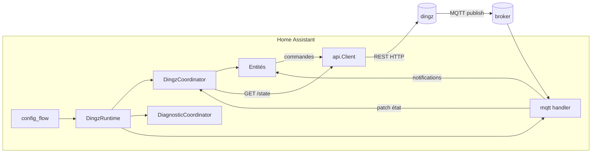
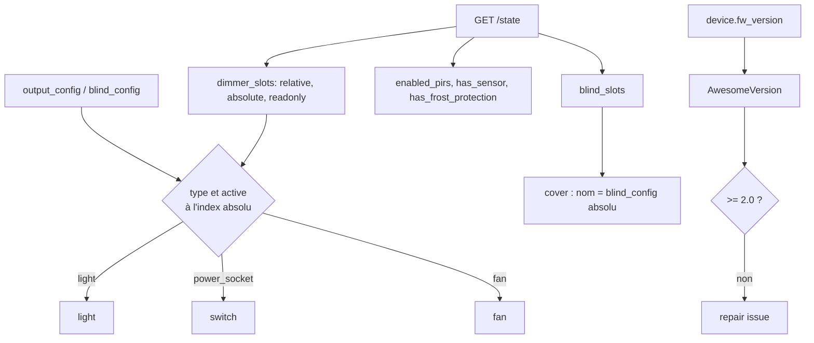

# Architecture

## Composants

| Module | Rôle |
| --- | --- |
| `api.py` | Client REST (`aiohttp` de HA), `TypedDict` des payloads, sérialisation et limitation (1 requête / 200 ms), nouvelles tentatives (GET et commandes idempotentes, jamais sur 4xx ni pour `reboot`), contrôle RAM après une 5xx |
| `capabilities.py` | Détection des capacités d'un dingz à partir de ses réponses : correspondance dimmers/moteurs relatif ↔ absolu, PIR actifs, capteurs présents, version de firmware, signature de structure |
| `coordinator.py` | `DingzCoordinator` (état 10 s, configuration, rechargement si la structure change), `DiagnosticCoordinator` (RAM 60 s), `DingzRuntime` (client, coordinateurs, `DeviceInfo`, diffusion des notifications MQTT) |
| `mqtt.py` | Abonnement optionnel aux topics du dingz, conversion en notifications internes, mise à jour de l'état du coordinateur |
| `entity.py` | Bases communes (`DingzEntity`, `OutputMixin`, notifications), `async_command` (erreurs traduites), `output_slots` |
| Plateformes (`light.py`, `cover.py`, …) | Une plateforme par domaine HA |
| `config_flow.py`, `diagnostics.py` | Configuration, découverte, reconfiguration ; diagnostics masqués |

## Flux

- **REST** est la source de vérité et l'unique chemin de commande. Après une commande, l'entité attend 1 s puis demande un rafraîchissement (le firmware met à jour `GET /state` avec un léger délai).
- **MQTT** accélère les mises à jour et fournit ce que REST n'a pas (événements de boutons, énergie). Les messages modifient la copie d'état du coordinateur via `async_patch_state`, **sans** reporter le polling REST.

## Capacités et versions

Ordre de priorité : capacités annoncées dans les réponses (présence d'un champ, `readonly`, `enabled`), puis configuration matérielle (index DIP), puis version de firmware (uniquement pour l'avertissement < 2.0). Une version inconnue n'empêche jamais le chargement.

## Décisions

| Décision | Raison |
| --- | --- |
| Entités créées depuis `state.dimmers` et non `output_config` | `output_config` liste 4 sorties même quand elles pilotent un moteur ; les commandes utilisent l'index relatif |
| `unique_id` inchangés (`output_<absolu>`, `cover_<relatif>`) | Préserver les installations : dans toutes les configurations observées, ces valeurs étaient déjà celles utilisées |
| Pas de suppression automatique des entités devenues fantômes | Une suppression d'entités de l'utilisateur doit rester une action explicite |
| `smart_light` non exposé | Alimentation permanente des ampoules connectées |
| Pas de bibliothèque PyPI séparée | Le client est petit, interne et typé ; une bibliothèque n'apporterait qu'une indirection |
| Commandes MQTT non utilisées | Une seule voie de commande (REST), plus simple à fiabiliser |
| Rechargement de l'entrée quand la structure change | Les entités sont figées au chargement des plateformes ; un rechargement est simple et sûr |
